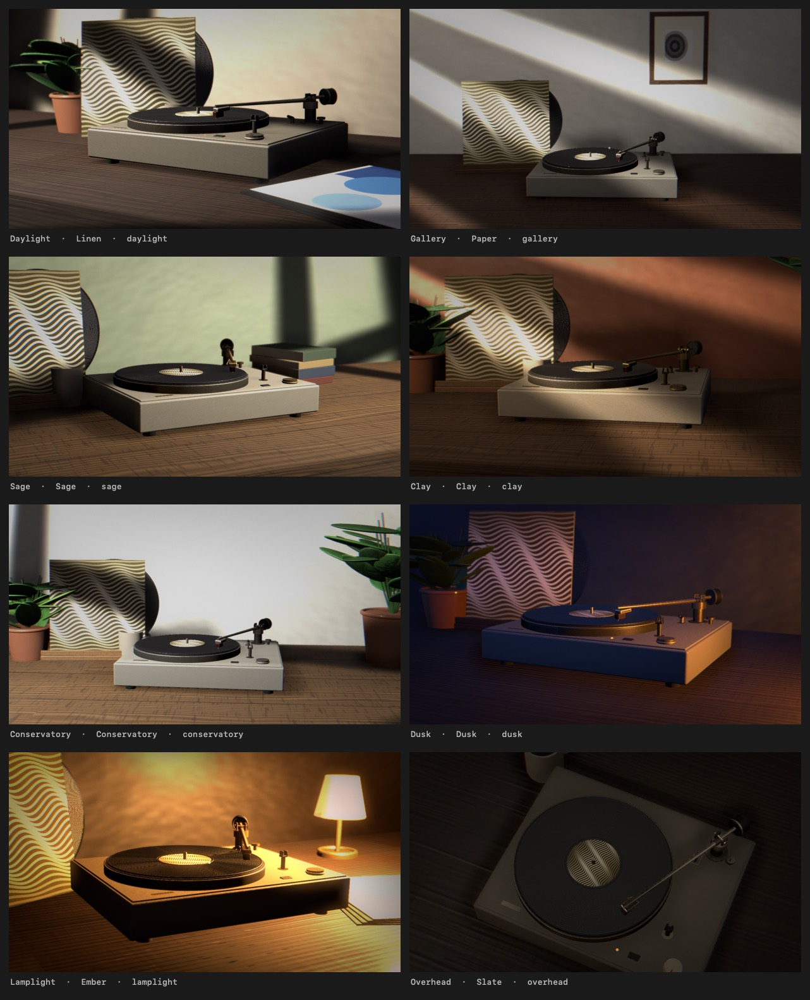

<div align="center">


# Spindle

**A turntable for your Mac desktop.**

Play something in Music or Spotify and its cover drops onto the record.
The platter spins while the track plays, and stops when you pause.


</div>

## Features

* Your album art, on a spinning record, behind your desktop icons
* Eight scenes to pick from
* Coloured pressings, and you can add your own
* Can match your lock screen too
* Lyrics, in sync, in a place chosen for each scene (experimental)
* Lives in the menu bar and stays out of the way
* Free and open source

## Scenes



| | |
| --- | --- |
| **Daylight** | Morning, and the window is doing most of the work |
| **Gallery** | A white room, a wooden desk, the blinds half open |
| **Sage** | Green walls, pale oak, and a quiet afternoon |
| **Clay** | Terracotta plaster, low sun, one plant for balance |
| **Conservatory** | White walls, light oak, and more plants than sense |
| **Dusk** | Blue outside, warm inside, the last side of the night |
| **Lamplight** | One lamp, side two, nobody else awake |
| **Overhead** | Straight down on the deck, nothing else in the frame |

## Install

Download the latest `.dmg` from [Releases](../../releases), open it, and drag
Spindle to your Applications folder.

The first time it runs, macOS asks for permission to read Music or Spotify.
Allow it, and your cover art shows up.

Nothing leaves your Mac unless you turn on **Look lyrics up online**, which
sends the track name, artist, album and length to `lrclib.net` so it can find
the words. That setting is off until you switch it on, and it is the only
thing in Spindle that talks to anything.

Lyrics are marked experimental: whether a track has any, and whether the lines
are timed, depends entirely on what the database holds for it.

## Build from source

You need macOS 13 or later and the Xcode Command Line Tools
(`xcode-select --install`).

```sh
git clone https://github.com/svviitzerland/spindle.git
cd spindle
make run
```

`make run` builds the app and launches it. `make stop` quits it.

## License

MIT. See [LICENSE](LICENSE).
