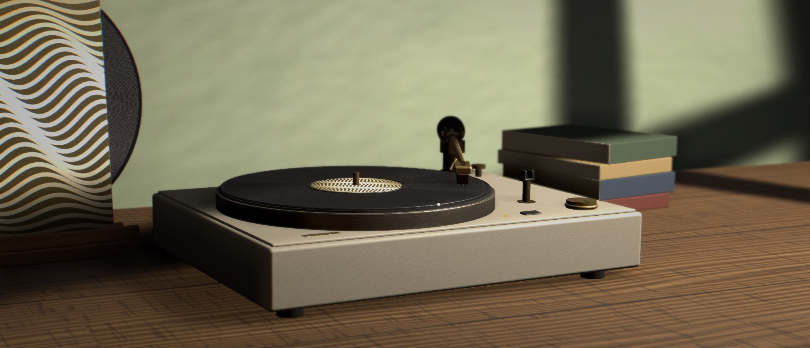
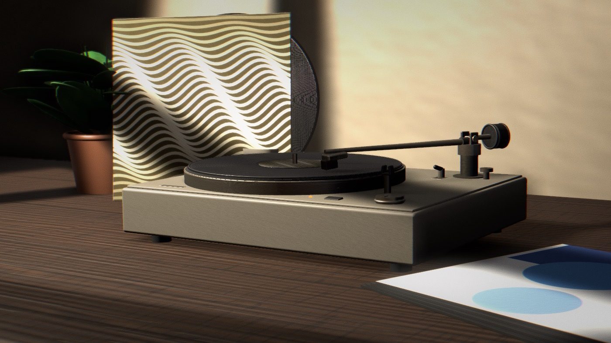
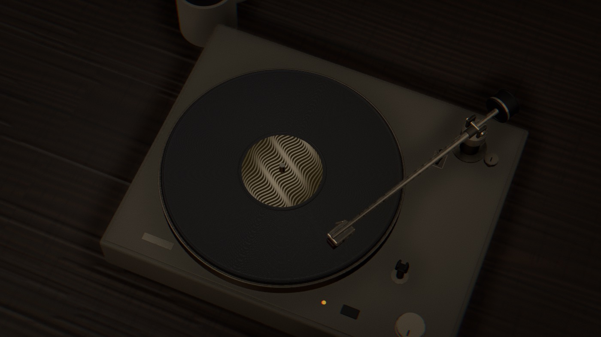
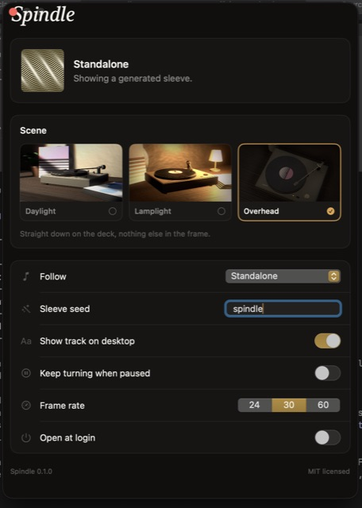

<div align="center">


# Spindle

**A turntable on your Mac desktop.**

Play something in Music or Spotify, and that album's cover lands on the record.
The platter turns while the track plays and stops when you pause it.



Free and open source.

</div>

## What you get

* A record player sitting behind your desktop icons.
* The cover of whatever you are playing, on the label.
* Three scenes to choose from.
* A small menu bar icon. No Dock icon, no window in the way.
* No account and no sign in.

## Scenes

| Daylight | Lamplight | Overhead |
| :-: | :-: | :-: |
|  |  |  |
| Morning light through a window | One lamp, late at night | Straight down on the deck |

## Install

Download the latest `.dmg` from [Releases](../../releases), open it, and drag
Spindle to your Applications folder.

Spindle then appears in the menu bar. That is the whole setup.

## Settings

Click the menu bar icon and choose **Settings**.

<div align="center">

</div>

From here you can switch scenes, choose which music app to follow, show or hide
the track name on your desktop, and have Spindle open at login.

Set **Follow** to **Standalone** if you want the wallpaper without any music.
Spindle then draws its own cover art instead.

## Permissions

The first time Spindle looks at your music, macOS asks whether to let it
control Music or Spotify. Allow it, and the cover art shows up.

If you say no by accident, macOS will not ask again. Turn it on in **System
Settings › Privacy & Security › Automation**, then click **Re-check** in
Spindle's settings.

Everything stays on your Mac. Spindle never uploads anything.

## Saving a still wallpaper

Prefer a normal wallpaper image? Choose **Save Current Scene as Image** from the
menu bar. Spindle renders the scene at your screen's full resolution and saves
it as a PNG.

## Building it yourself

You need macOS 13 or later and the Xcode Command Line Tools
(`xcode-select --install`). Nothing else to install.

```sh
git clone https://github.com/svviitzerland/spindle.git
cd spindle
make run
```

`make run` builds the app, puts it in `dist/`, and launches it.
Use `make stop` to quit it.

## License

MIT. See [LICENSE](LICENSE).
